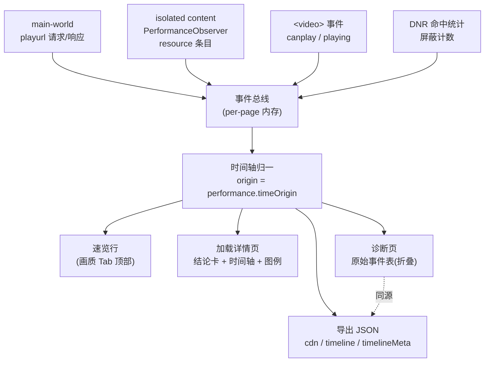

# 实施方案：屏蔽 PCDN + 加载时间轴可视化 + 诊断页重构

日期：2026-11-17
> 📝 **草案** —— 待用户拍板。本文件只描述"怎么改"，**一个字的代码都还没动**。
状态：**待评审**（未经用户批准，不得进入实现）
范围：只出方案，不含实现代码

---

## 0. 一句话

先让人**看见**走了哪条线路（只读），再给一个**能关掉的减法开关**（屏蔽 PCDN），
用时间轴把"第几秒发生什么"讲清楚；诊断页保留但降级为高级入口。

---

## 0.1 ⚠️ v2 修订：需求 1 撞上权限墙（必读）

**「屏蔽 PCDN」在当前权限模型下不能直接实现。** 这不是设计问题，是 Chrome 扩展权限语义。

`wxt.config.ts` 现状：

```
permissions:     ['storage', 'cookies', 'tabs', 'declarativeNetRequestWithHostAccess']
host_permissions: ['*://*.bilibili.com/*', '*://live.bilibili.com/*', 三条 GitHub]
```

官方文档原文：`declarativeNetRequestWithHostAccess` —— *"A permission warning is not shown
at install time, but **you must request host permissions before you can perform any action on
a host**"*。`block` 属于"action on a host"，**同样受此约束**。
而 `bilivideo.com` / `bilivideo.cn` / `mountaintoys.cn` **不在** `host_permissions` 里。

三条出路，必须由用户裁决（详见 §11 Q6）：

| 方案 | 做法 | 代价 |
| --- | --- | --- |
| **A. 加窄主机权限** | 只加 PCDN 域（`*.mcdn.bilivideo.cn`、`*.mountaintoys.cn`、`*.szbdyd.com`、`*.qrstuvwxyzab.com`、`*.zhenidc.cn`） | 安装/更新时权限提示变化；**PCDN 域名表被写死**，B站 换域名就得发版（§3 决策 6 禁远程配置） |
| **B. 改用 `declarativeNetRequest`** | 换掉 `declarativeNetRequestWithHostAccess` | 安装时弹 **「屏蔽任何页面上的内容」**——对"画质助手"来说是很重的警告；但 `block` 免主机权限 |
| **C. 只做诊断，不做屏蔽** | 砍掉需求 1 | 零风险、零授权成本；但"避不开 PCDN" |

> **本次建议：先做 C 的全部 + A 的诊断，把屏蔽单独排在用户裁决之后。**
> 诊断能力不依赖任何新权限，可以立刻落地；屏蔽是唯一会动权限模型的部分。

> ✅ **2026-11-17 更新 —— 本节已不再阻塞。** 用户指示「以目前需求优先，ADR 0017 不用管」，
> 于是「屏蔽」改走 **§12 的 playurl 候选过滤**：只从 B站 当次下发的候选里**剔除 PCDN**，
> 不发明 host、不碰权限模型。下面是留档的原始权衡，**不必再裁决**。

其余 v2 修订已就地并入 §4.4 / §6 / §7 / §11。

---

## 1. 已实证的事实（本方案的地基，全部来自实测，不是推断）

| # | 事实 | 怎么测的 | 对方案的影响 |
| --- | --- | --- | --- |
| F1 | 播放器**已内置 backupUrl 自动回退且实际生效** | Edge 打开真实视频页；25 次媒体请求全落 `upos-sz-mirrorcoso1`，PCDN 两条全 `ERR_TIMED_OUT`，视频仍 22.2s 流畅播、buffered 45s、无 error | **不需要自己做故障转移**，只要让劣质线路不可达 |
| F2 | 每条流 **1 个 baseUrl + 2 个 backupUrl**；6 视频流 + 3 音频流，去重 20 个 host | 连抓 playurl | 候选天然有三条，屏蔽有冗余空间 |
| F3 | **候选集合每次请求都在变** | 同视频连抓 3 次：第 1 次 6 条全是自建 CDN；第 2/3 次 1 mountaintoys + 5 mcdn | **静态"属地优选"不可靠**；屏蔽（做减法）比选线（做排序）稳 |
| F4 | `mcdn` 主线路 path 带 `/v1/resource`，mountaintoys 不带 | 同上 | 路径前缀与 CDN 类型绑定 → 否决"改 host 重定向"路线 |
| F5 | PCDN 域名在阿里/腾讯/Google 公共 DNS 都返回 **0.0.0.0** | 三组 resolver 交叉验证 | 是定向解析，不是节点故障；不能拿"节点死了"当论据 |
| F6 | `upsig` **不绑定 host**（换 host 仍 206） | 把 upos host 套原 base 的签名参数 | 技术上可以换 host，但**本方案主动不做**（见 §2） |
| F7 | **bilivideo 响应不带 `Timing-Allow-Origin`** | 实测该头为"无"；同一条条目 `transferSize`/`encodedBodySize`/`requestStart`/`responseStart` 全为 0 | 时间轴**只能**画「发出 / 完成」两点 + `duration`；**画不出 TTFB/DNS/TLS**，**拿不到字节数与速度** |
| F8 | `PerformanceObserver` 能看到媒体请求，`entry.name` 含完整 host，`initiatorType=xmlhttprequest` | 一次抓到 43 条 bilivideo 系条目 | "实际在用哪条线路"这条路成立 |
| F9 | 实际取流可能是 `cn-cq-gd-bcache-19.bilivideo.com`（自建） | 同上 | 分类函数必须认自建 CDN，不能只认 `upos` |

---

## 2. 范围

### 做

| 编号 | 内容 |
| --- | --- |
| A | CDN 分类纯函数（`core/`，可单测） |
| B | 只读诊断：显示**实际在用**哪条线路 |
| C | 「屏蔽 PCDN」：**DNR block 已废弃（见 §7）**，改为**取流数据上的候选过滤**（§12，授权见 [ADR 0038](../../docs/decisions/0038-filter-pcdn-candidates.md)） |
| D | 加载时间轴面板（普通用户主视图） |
| E | 诊断页降级 + 导出 JSON 扩字段 |

### 明确不做

| 不做 | 理由 |
| --- | --- |
| 测速选线（挑最快的一条） | 必须阻塞起播；换来的只是省掉一次注定失败的尝试，而播放器本来就会退（F1）。**净收益 ≤ 0** |
| 改 host / URL 重定向 | 路径前缀与 CDN 类型绑定（F4），正则替换脆；且要碰请求改造 |
| ~~改 playurl 响应体~~ | ~~**ADR 0017 明文禁止改 `dash`**。本方案全程不碰响应体~~ —— ⚠️ **已被 §12 推翻**：v3 改走候选过滤，并由 [ADR 0038](../../docs/decisions/0038-filter-pcdn-candidates.md) 授权"只减不增"地动 `dash[].base_url` / `backup_url`（其余字段仍禁改）。这一行保留只为说明 v2 当时的边界 |
| 显示下载速度 / 实测码率 | 跨域计时拿不到字节数（F7） |
| 按历史自动开关 | 不做自动决策，只给手动开关 |
| 远程规则下发 | 违反 §3 决策 6 |

---

## 3. 数据层设计

### 3.1 数据流



### 3.2 CDN 分类函数（`core/cdn/classify.ts`）

放 `core/` 的硬理由：纯函数、零浏览器 API、可被 Vitest 全覆盖；且 `core/` 不许出现 `window`/`document`（§5.1）。

输入 `host`（小写）+ 可选 `search`（query 串），输出：

```ts
type CdnKind = 'official' | 'pcdn' | 'third-party' | 'unknown';

/**
 * official 的二级分类 —— **只用于显示，不参与过滤判断**。
 * 屏蔽逻辑只问 "是不是 pcdn"，不问官方是哪一种；
 * 拆成两个字段是为了让"普通层也能说清是官方镜像还是自建"。
 */
type OfficialFlavor = 'partner' | 'self-built' | null;  // 非 official 时恒为 null

function classifyCdn(host: string, search?: string): { cls: CdnKind; flavor: OfficialFlavor };
```

判定顺序（**先命中先返回**）：

| 序 | 条件 | `cls` | `flavor` |
| --- | --- | --- | --- |
| 1 | 不是合法主机名（空串 / `blob:` / `data:` / 无 `.`） | `unknown` | `null` |
| 2 | 裸 IPv4（`^\d{1,3}(\.\d{1,3}){3}$`）或裸 IPv6 | `pcdn` | `null` |
| 3 | host 的任一**标签**等于 `mcdn` / `pcdn` / `gotcha` | `pcdn` | `null` |
| 4 | host 后缀命中 `szbdyd.com` / `mountaintoys.cn` / `qrstuvwxyzab.com` / `zhenidc.cn` | `pcdn` | `null` |
| 5 | query 按 `&` 切段后有**整段**等于 `os=mcdn`（**任何 host 都算**） | `pcdn` | `null` |
| 6 | host 匹配 `^cn-[a-z0-9-]+\.bilivideo\.(com\|cn)$`（**`cn-` 行首锚定即可，不要求 `bcache`**） | `official` | **`self-built`** |
| 7 | host 匹配 `^upos-[a-z0-9-]+\.bilivideo\.com$` | `official` | **`partner`** |
| 8 | host 属于 `bilivideo.com` / `bilivideo.cn` 子域 | `official` | **`null`**（认不出是哪一种，就**不猜**） |
| 9 | host 属于 `akamaized.net` | `third-party` | `null` |
| 10 | 其余 | `unknown` | `null` |

> 第 5 条来自参考实现：正规镜像也可能代理 mcdn 资源，只看域名会漏判。
> **它排在官方判定之前、且不限定域名** —— 与参考实现的 `isRiskyCdnUrl = 危险host || query含os=mcdn` 同口径。
> 第 3/4/5 条**必须**排在第 8 条之前（见下方"顺序即语义"）。

#### `flavor` 的三种取值（为什么第 8 条给 `null` 而不是猜）

| 值 | 含义 | 用户看到 |
| --- | --- | --- |
| `self-built` | B站自建边缘，命名 `cn-<地区>-<运营商>-<节点>`（实测：`cn-cq-gd-bcache-19`、`cn-sccd-ct-02-13`、`cn-jsnt-ct-01-06`；**`bcache` 只是其中一种节点类型**） | `B站官方线路（自建 CDN）` |
| `partner` | CDN 服务商镜像（`upos-*`） | `B站官方线路（服务商 CDN）` |
| `null` | 在官方域内但认不出机型 | `B站官方线路`（**不加括号**） |

**宁可不说，不许说错**。给 `null` 加括号就等于替 B站 编一个机型归属，而用户会拿它去对照右键统计信息 —— 一说错就被抓。

> 口径参考：B站 播放页右键「视频统计信息 → Video Hosts」自身就把 `upos-sz-mirror****.bilivideo.com`
> 标为服务商 CDN、`cn-****-*-bcache-**` 标为自建 CDN。我们的括号**必须与它一致**，
> 否则用户看到两个界面各说一套。


#### ⚠️ 顺序即语义：PCDN 判据必须**先于**同域兜底

`mcdn.bilivideo.com` 与 `xy116x196x140x25xy.mcdn.bilivideo.com` 实测都存在（公共 DNS 同样返回
`0.0.0.0`）—— **它们是 `bilivideo.com` 的子域**。所以第 6 条的"同域即官方"必须放在第 2 条
（含 `mcdn`）**之后**；否则 PCDN 会被认成官方，开关开了也拦不住，而且**报错方向是"看起来正常"**。

必须有的三条对照测试（写进 T1 的判据）：

| 输入 | 期望 | 防的是 |
| --- | --- | --- |
| `mcdn.bilivideo.com` | `pcdn` | 同域兜底抢答 |
| `xy1.mcdn.bilivideo.cn` | `pcdn` | 子域匹配 |
| `upos-sz-mirrorcos.bilivideo.com` | `official` + `partner` | 误伤官方 / 括号说错 |
| `cn-cq-gd-bcache-19.bilivideo.com` | `official` + `self-built` | 自建认成服务商 |
| `some-new-edge.bilivideo.com` | `official` + `null` | **猜测机型**（必须不加括号） |


### 3.3 事件模型

```ts
type LoadStage =
  | 'nav'          // 页面开始（原点，t = 0）
  | 'playurl-req'  // 取流请求发出
  | 'playurl-res'  // 取流响应到达（候选下发）
  | 'ext-patch'    // 扩展介入（改写了响应 / 已代理）
  | 'seg-req'      // 首个媒体分片发出
  | 'seg-res'      // 首个媒体分片完成
  | 'canplay'      // 可以播放
  | 'playing'      // 真正开始播（**"加载完成"就用这个口径**）
  | 'switch'       // 播放中实际线路发生变化
  | 'stall'        // 卡顿（waiting 事件，可累计次数）
  | 'error'        // 播放出错（只记 MediaError.code，不记 message）
  | 'blocked';     // 被屏蔽规则拦下（仅开关开启时）
```

```ts
interface LoadEvent {
  t: number;          // ms，相对 performance.timeOrigin
  stage: LoadStage;
  host?: string;      // 仅 hostname，永不带 query
  kind?: CdnKind;
}
```

**字段取舍的理由（都是硬约束推出来的）**：

| 想记录的 | 能不能 | 为什么 |
| --- | --- | --- |
| 请求发出时刻 | ✅ `startTime` | F8 |
| 请求完成时刻 | ✅ `responseEnd` | F8 |
| 耗时 | ✅ `duration` | F8 |
| 首字节时刻（TTFB） | ❌ | F7：`responseStart` 恒为 0 |
| DNS / TCP / TLS 细分 | ❌ | 同上 |
| 字节数 / 速度 | ❌ | F7：`transferSize`、`encodedBodySize` 恒为 0 |
| 完整签名 URL | ❌ **禁止** | `upsig`/`uparams`/`deadline` 是取流凭据；与参考实现"签名地址绝不落盘"同口径 |

### 3.4 时间轴归一

- 原点**只能是** `performance.timeOrigin`，因为 `startTime` 天然相对导航开始。
- **打点统一在 isolated 单源产生**（全部读 resource 条目 + `<video>` 事件），不跨 world 拼时间戳 ——
  同一条 entry 的 `startTime` / `responseEnd` 天然有序，因此**不存在时钟偏差**。
- 某个事件缺失时：**不画该节点**，不补 0、不补假时间。缺一个节点比画错一个时间戳安全。

#### 归一管线（顺序固定）

**丢非法 → 排序（`t` 升序，次键 `LoadStage` 声明顺序）→ 去重 → 截断**

- **不做时间戳夹平**。`t` 就是事实，没有"修正"这一步，所以也**没有 `adjusted` 字段** ——
  留一个恒为 0 的审计字段等于给后人一个假信号。
- 万一真出现 `res` 早于 `req`（同源时不该发生），**照原样显示**，那是真实数据，不许抹平。
- 去重键：`t` + `stage` + `host` 三者全同。
- 截断：超过上限保留**最新**的 N 条，并置 `truncated`。

#### 采集器三条硬约束（工程细节，漏一条就丢数据）

1. **必须 `new PerformanceObserver(cb).observe({ type: 'resource', buffered: true })`**
   —— 不带 `buffered: true` 时，播放器在 content script 注入的**之前**就已发出的分段请求永远抓不到
   （首屏抢跑是常态，不是边缘情况）。
2. **不调用 `performance.setResourceTimingBufferSize()`** —— 那是改页面全局状态，
   observer 消费完即出队，本方案不需要扩容，别为了让数据更多去动页面的东西。
3. **只按 host 过滤，不看 `initiatorType`** —— 实测 MSE 分片是 `xmlhttprequest`，
   但 PGC 通道可能走 `fetch`；按类型白名单会漏。
   容量：环形 200 条 + 独立的 `Map<host, count>`（计数不能靠遍历事件算，事件会被挤掉）。


### 3.5 存储策略

| 数据 | 放哪 | 理由 |
| --- | --- | --- |
| 时间轴事件 | **仅内存**，每 content script 实例一份，上限 200 条 | 只在本文档有意义；且不落盘才可能保证不写签名 URL |
| 当前线路结论 | 内存 + 面板渲染 | 同上 |
| 自检事实 / 日志 | 沿用现有 `diag-store` 环形缓冲 | 不动 |
| 导出包 | 用户点导出那一刻现组 | 沿用现有 `buildExportPayload()` 纪律 |

---

## 4. 界面结构

### 4.1 三层，不是一层

| 层 | 位置 | 受众 | 内容 |
| --- | --- | --- | --- |
| L1 速览行 | 画质 Tab 顶部 | 所有人，扫一眼 | `● 官方 CDN · 4K · 已缓冲 45s` |
| L2 加载详情页 | 二级浮层（点 L1 进入） | 关心"这次顺不顺"的人 | 结论卡 + 时间轴 + 图例 |
| L3 诊断页 | 现有入口（保留） | 排障的人 | 自检事实 + 日志 + **新增折叠的原始事件表** + 导出 |

### 4.2 L2 加载详情页线框

```
┌────────────────────────────────────────────┐
│ ‹ 返回        本次加载            ⟳        │
├────────────────────────────────────────────┤
│  ╭───╮  本次加载                           │
│  │ ✓ │  走了 B站官方线路（自建 CDN）       │
│  ╰───╯  [官方 CDN]                         │
│         ⏱ 2.4s   ▤ 3 条线路   ⛔ 0 次屏蔽   │
├────────────────────────────────────────────┤
│  ● 0.00s  页面开始                         │
│  │        打开视频页                        │
│  ● 0.42s  发出取流请求                     │
│  │        /x/player/wbi/playurl             │
│  ● 0.71s  B站 返回 3 条候选线路            │
│  │        官方 2 · PCDN 1                   │
│  ◇ 0.73s  扩展介入                         │
│  │        已用取流账号代理 · 未改画质字段   │
│  ● 0.81s  开始下载第一段视频               │
│  │        upos-sz-mirrorcos                 │
│  ● 1.02s  首段下载完成（0.21s）            │
│  ● 1.35s  可以播放                         │
│  ● 1.62s  开始播放                         │
├────────────────────────────────────────────┤
│ 图例  ● 官方 CDN   ◆ PCDN   ▲ 第三方              │
│      （颜色 + 形状双重区分，见 §4.4）       │
├────────────────────────────────────────────┤
│  查看完整诊断 ›                            │
└────────────────────────────────────────────┘
```

### 4.3 结论卡（借参考实现的 `_VerdictCard` 结构）

- 左：44px 圆图标，底色 = 语义色 14% alpha
- 中：小标签「本次加载」+ 结论大字（`titleLarge` 级别）
- 右：类型徽章（`官方 CDN` / `PCDN` / `混合`）
- 下：一排 chips —— 总耗时、候选条数、屏蔽次数

结论文案只有四种（**括号是第五种可变部分，不是第五种结论**），**不拼自由文本**：

| 结论 | 何时 |
| --- | --- |
| `走了 B站官方线路` + 括号 | 实际 host 全是 official。括号取 §3.2 的 `flavor`：`（自建 CDN）` / `（服务商 CDN）` / **不加**（`flavor === null`） |
| `走了第三方加速线路（PCDN）` | 实际 host 有 pcdn 且非被拦 |
| `已屏蔽 PCDN，改走官方线路` + 括号 | 开关开启且确实剔除了 pcdn。括号同上 |
| `暂时判断不出` | observer 无条目（降级态，必须诚实） |

> 括号的三种形态是**枚举拼接**，不是自由文本：`（自建 CDN）` / `（服务商 CDN）` / 空。
> 第四种"混合"等复杂情况一律退化成不加括号，绝不发明新词。


### 4.4 图例与颜色（色盲可用性）

**一个主动收窄：颜色只编码"来源"，不编码"阶段"。**

需求原文是"用不同颜色区分不同来源/阶段"。但 4 类来源 × 10 个阶段 = 16 种颜色，
**不可辨**；而时间轴的**纵向位置 + 序号本身已经编码了阶段**，再上色是冗余，
且会占掉唯一的颜色通道。所以拆成两条正交通道：

| 编码对象 | 编码方式 | 取值 |
| --- | --- | --- |
| **来源分类** | 圆点颜色 **+ 文字标签（必需）** | 官方=成功绿 / PCDN=警示橙 / 第三方=文字灰 / 未知=虚线描边 |
| **阶段** | **纵向位置 + 序号 + 图标形状** | 中性色；只有"当前走到哪一步"用主色 `--pluma-accent` |
| **异常** | 红 + 文字「失败」 | `--pluma-danger`（**只给 playback error，不给 PCDN** —— PCDN 只是"可能更慢"，不是故障） |

**色盲可用性四条**：
1. 颜色不是唯一编码 —— 每一行都有文字直写类型；
2. 形状差异（实心圆 / 空心菱形 / 空心三角 / 虚线）在灰度下仍可辨；
3. **不用红绿表达好坏**：PCDN 用 warning 橙而非 danger 红；
4. 新配色必须补进 `tests/unit/design/contrast.test.ts` 的 cases（图形 ≥3:1、文字 ≥4.5:1）。

**⚠️ `flavor`（自建 / 服务商）不新增颜色，只走文字括号。**
官方本来就是一色一格，再拆两个颜色会把"来源"这一维撑成 5 档，图例跟着膨胀，
而这两个子类的**用户动作完全相同**（都是"不用管它，好线路"）。
所以括号是**信息补充**，不是**新的编码维度** —— 颜色与形状不变，图例也不会为它新增一项。

### 图例是**动态**的（2026-11-17 落地时定稿，上图的四项示意已作废）

图例只列**本次真出现过的来源类别**，一项都没有时连「图例」小标题都不画：

| 项 | 出现条件 |
| --- | --- |
| `● 官方`（自建 / 服务商） | `hosts` 或 `events` 里出现过 `official` |
| `◆ P2P` | 出现过 `pcdn` |
| `▲ 第三方` | 出现过 `third-party`（判据只有 `akamaized.net`，**20 个视频实测 0 命中**，国内基本见不到） |
| `○ 扩展介入` | 本次真的收到 `ext-patch` 事件（main-world 改写成功后上报）。**没有数据源就不画** —— 曾经写死过这一项，等于承诺一个永远不出现的类别 |

> 写死四项的那版已废弃。理由：图例的作用是"解释你正在看的东西"，列一个本次不存在的类别只会让人去找它。

> 若用户坚持"阶段也要颜色"，这个决定要回来重议 —— 代价是至少新增 3 个令牌，
> 并撞上 `02-ui-spec.md` §6.1 的「蓝只给当前与可执行」。


### 4.5 文案分层（术语保留策略）

原则：**普通层保留名词本体（用户搜故障要用这个词），只把解释换成白话；技术层保留完整 host。**

| 术语 | 普通层（L1/L2） | 技术层（L3/导出） |
| --- | --- | --- |
| PCDN | `第三方加速线路（PCDN）` | `PCDN · mcdn.bilivideo.cn` |
| 官方 CDN · 服务商镜像 | `B站官方线路（服务商 CDN）` | `官方 CDN · partner · upos-sz-mirrorcos` |
| 官方 CDN · 自建 | `B站官方线路（自建 CDN）` | `官方 CDN · self-built · cn-cq-gd-bcache-19` |
| 官方 CDN · 认不出机型 | `B站官方线路`（**不加括号**） | `官方 CDN · flavor=null · some-new-edge` |
| `backupUrl` | 不出现 | `备用线路（backupUrl）` |
| `upsig` / `uparams` | 不出现 | `签名参数已省略` |
| DNR | 不出现 | `屏蔽规则（DNR）` |
| MCDN | 不出现 | `MCDN` |

**判断某句该不该留的标尺**（沿用项目既有规范精神）：*删掉这句，用户会不会多做错一件事？*
会 → 留；不会 → 删。

---

## 5. 诊断页结论

### 保留，但降级 + 增补，不合并

| 维度 | 诊断页 | 加载详情页 |
| --- | --- | --- |
| 回答的问题 | 扩展各模块是否正常 | 这一次播放顺不顺 |
| 使用频率 | 出问题时 | 每次播放 |
| 第一屏密度 | 十几行自检事实 | 一个结论 + 一条时间轴 |
| 受众 | 高级用户 / 报障 | 普通用户 |

**不合并的理由**：合并后普通用户第一屏会被十几行自检事实淹没（现状即如此）；而把自检事实砍掉，高级排障就没了依据。两者受众与频率都不同。

**改进**：
1. 诊断页顶部新增「本次加载」区块 —— 一行摘要 + 可展开的**原始事件表**（`# / t / stage / host / kind`），默认折叠
2. 诊断页原有「自检信息」「诊断日志」「导出」**一字不动**
3. 加载详情页底部提供「查看完整诊断 ›」，作为两个页面的唯一连接点

---

## 6. 导出 JSON

### 6.1 从 7 个字段扩到 **8 个**（只增不改）

前 7 个（`exportedAt` / `version` / `facts` / `logs` / `trace` / `echo` / `logsMeta`）**一字不动**，
形状守卫测试不需要改既有部分。

**只新增 1 个字段 `loading`**（不是 3 个）。理由：`buildExportPayload()` 的"只包固定字段"
本身就是凭据防线，**字段越少越好守**；三块数据合成一个对象，守卫只需在顶层加一项。

```jsonc
{
  // ... 原 7 个字段不变 ...

  "loading": {
    "present": true,
    "confidence": "measured",        // 'measured' | 'inferred' | 'none'
    "actual": {                       // 实际在用（不是候选）
      "host": "upos-sz-mirrorcos.bilivideo.com",
      "cls": "official",              // 'official' | 'pcdn' | 'third-party' | 'unknown'
      "flavor": "partner"             // 'partner' | 'self-built' | null（仅 cls=official 时非 null）
    },
    "candidates": {
      "total": 3, "official": 2, "pcdn": 1, "thirdParty": 0, "unknown": 0,
      "hosts": [                      // 最多 20 条
        { "host": "xy116x196x140x25xy.mcdn.bilivideo.cn", "cls": "pcdn", "flavor": null, "count": 9 }
      ],
      "truncated": false
    },
    "events": [                       // 最多 40 条，kind 为枚举
      { "t": 420,  "kind": "playurl-req" },
      { "t": 712,  "kind": "playurl-res" },
      { "t": 812,  "kind": "seg-req", "host": "upos-sz-mirrorcos.bilivideo.com", "cls": "official" },
      { "t": 1804, "kind": "playing" }
    ],
    "eventsTruncated": false,
    "video": { "readyState": 4, "durationSec": 213, "bufferedAheadSec": 45, "errorCode": 0, "width": 1920, "height": 1080 },
    "filter": {                       // v3 候选过滤（原 DNR block 字段已废弃，见 §12）
      "enabled": true,
      "removed": 1,                   // 本次剔除的 PCDN 候选条数
      "degraded": null                // null | 'all-pcdn'（整条流只有 PCDN → 原样保留）
    },
    "capturedAt": 1763318400000
  }
}
```

### 6.2 硬裁剪规则（凭据防线）

| 规则 | 做法 |
| --- | --- |
| **剥 query** | `host` 只存 hostname；`upsig` / `uparams` / `w_rid` / `deadline` 永不出现 |
| **不存 path** | path 含 aid/cid/文件名，对排障无用，且能被拼成完整可取流地址 |
| **枚举化** | `kind` / `cls` / `flavor` / `confidence` / `degraded` 只允许枚举值，禁止自由文本 |
| **`note` 必须剥掉** | `LoadEvent.note` 只在内存里给界面用，**导出层必须显式删除**（`buildTimeline` 不剥它，剥是导出层的责任） |
| **不导出"被修正"的指标** | 时间戳不做任何夹平/修正，因此没有 `adjusted` 这类字段 —— 一旦出现，说明有人在改数据 |
| **唯一 string 是 `host`** | 必须过 `sanitizeHost()`：只允许 `[a-z0-9.-]{1,253}`，否则写 `'invalid'` |
| **`MediaError.message` 不导出** | 只留 `code`（message 是浏览器自由文本，会变成未知内容出口） |
| **不导出恒 0 的字段** | 无 TAO 时 `transferSize` / TTFB 恒为 0，写进去等于编数据 |
| **相对时间** | 只存相对 ms，不存绝对时间戳（减少指纹） |
| **`ok` 与 `count` 必须分开** | 沿用现有 `logsMeta` 的教训：读失败不能伪装成"没有数据" |
| **扫描词表扩项** | `panel-diagnostics-export.test.ts` 加 `upsig|uparams|w_rid|sign|token` |

---

## 7. 屏蔽 PCDN：DNR block 方案（**v3 已废弃，改为 §12**）

### 7.1 规则形态

- 新增第三类规则段 **`BLOCK_RULE_BASE = 30000`**
  （现有 `PATH_RULE_BASE=10000` 占 10000–10999、`FEED_RULE_BASE=11000` 占 11000–11999、
  `TAB_RULE_BASE=20000` 占 20000–29999 —— 所以 30000 起才是空段）
- `action: { type: 'block' }`
- `condition` 用 **`requestDomains`**（DNR 原生做子域匹配，`mcdn.bilivideo.cn` 即可命中
  `xy116x196x140x25xy.mcdn.bilivideo.cn`），比逐条 `urlFilter` 稳且省规则数
- `resourceTypes` **只列三种**：`['media', 'xmlhttprequest', 'other']`
  - `xmlhttprequest` 是主通道（实测 `initiatorType=xmlhttprequest`，F8）
  - `media` 兜底 `<video src>` 直达形态
  - ⚠️ **绝不列 `main_frame` / `sub_frame` / `script`** —— 会 block 整页或静态资源
- `priority: 3`（高于现有 path 规则）
- **不改 `describeRules()` 的 `kind` 联合**（`'path' | 'tab'` 会传播到
  `countPathRules()` 与既有单测），改为新增 `describeBlockRules()`
- 分两步：**步 1** 在 30000 段内一次 `updateSessionRules({removeRuleIds, addRules})`
  —— 段内天然原子，与另两段互不影响，**先做**；
  **步 2** 三类合并进同一次调用（重构 `applyRulePlan()`）—— 优化项、后做，
  做完要跑 `dnr-updatesessionrules-atomicity.cjs`
- ⚠️ **前提**：见 §0.1。当前权限模型下这条规则**不会生效**，必须先解决权限


### 7.2 作用域

- 按 tab 生效（`tabIds`），只在播放页；与现有 tab 规则的 tabIds 合并逻辑同源
- 不在首页/推荐流生效（那里没有播放分片）

### 7.3 开关语义

| 状态 | 行为 |
| --- | --- |
| 默认 | **关闭**。规则不下发 |
| 开启 | 下发 block 规则；面板显示「已屏蔽 N 次」 |
| 关闭 | 规则全部移除（`removeRuleIds`） |

用 `disabled` 而非 `dim`：关掉后播放仍可用，属"此刻被用户关掉"，不是"本质不可用"。

### 7.4 兜底（播不了怎么办）

1. 面板检测到"有屏蔽记录但 5 秒内无任何分片成功" → 顶部提示
   「本次播放没有可用线路，可能是屏蔽导致 —— 关闭屏蔽试试」+ 一键关闭按钮
2. **不自动关闭**（不做自动决策）
3. 开关旁常驻一行小字：「屏蔽后若晚高峰官方线路拥堵，B站 可能限制高码率速度」
   （来自用户实测反馈；这是必须让用户知道的反向代价）

### 7.5 为什么不违反 §3 决策 5

决策 5 管的是**响应体改写**。block 规则只让请求失败，**不修改任何响应内容**，播放器按自己的 `backupUrl` 逻辑回退（F1 已实测）。draw 流字段一个字节没动。

> ⚠️ 但这仍是**新决策**：§3 决策 3 定的是"`declarativeNetRequest` 换 Cookie 头"，新增 `block` 动作需要用户明确点头，并按项目惯例补一条 ADR。

---

## 8. 兼容性与隐私注意点

| # | 注意点 | 处置 |
| --- | --- | --- |
| C1 | 跨域无 TAO，只有 `startTime` / `duration` / `responseEnd`（F7） | 时间轴只画"发出/完成"，不画 TTFB/DNS/TLS |
| C2 | 拿不到字节数 | 不显示速度、码率、下载量 |
| C3 | 候选每次请求都在变（F3） | 结论只描述"这一次"，不承诺"总是" |
| C4 | 番剧整页加载走 SSR `__playinfo__`；SPA 切集走 `/ogv/player/playview` 再换 dash（ADR 0023） | 时间轴多一个「扩展换流」节点；分类逻辑通用 |
| C5 | 无痕分区（`incognito: split`） | 面板与 observer 在 split 分区各自实例化，导出照常 |
| C6 | Shadow DOM `closed` | 时间轴渲染在 shadow root 内；令牌必须注入（沿用现有做法） |
| C7 | 类名是测试契约（73 个） | 新增类名必须同步更新 `ui-class-contract.test.ts` |
| C8 | `PANEL_CSS` 是模板字符串 | 新样式里**注释不许出现反引号**（踩过 3 次） |
| C9 | **签名 URL = 取流凭据** | 时间轴不落盘；导出剥 query、不存 path |
| C10 | 时间轴不能进主日志环形缓冲 | `page/quality` 每几秒写一轮会把它冲干净；单独内存通道 |
| C11 | 孤儿态（扩展更新后 content 上下文失效） | 沿用现有 `logsMeta.ok` 口径：读失败必须显式说，不能伪装成空 |
| C12 | 分类函数放 `core/` | 不许出现 `window`/`document`/`chrome.`；observer 采集器放 content 层 |

---

## 9. 任务分解（按实现顺序）

| # | 任务 | 涉及文件 | 前置 | 完成判据 |
| --- | --- | --- | --- | --- |
| T1 | CDN 分类纯函数（计划新建） | `src/core/cdn/classify.ts` + 单测 | — | 9 条规则逐条有测试；`flavor` 三态各有用例；`mcdn.bilivideo.com` 必须判 pcdn |
| T2 | 事件模型 + 时间轴归一（计划新建） | `src/core/loading/timeline.ts` + 单测 | — | 缺事件不补 0；越界/乱序事件被丢弃而非重排 |
| T3 | observer 采集器（计划新建） | `src/content/isolated/perf-observer.ts` | T2 | 真实页面能读到 host；不可用时降级为 `primarySource='candidate'` |
| T4 | **零 main-world 改动**（v2 调整） | 不改 `src/content/main-world.js`；打点全部落在 `hello-timing.ts` 与 isolated 采集器 | T2 | `git diff --stat` 显示 `main-world.js` 零改动 |
| T5 | 速览行 | `tabs.ts`、`sidebar.ts` | T1,T3 | 三种线路各显示正确文案 |
| T6 | 加载详情页（计划新建） | 新 `src/content/panel/loading-pane.ts`、`dom.ts`、`sidebar.ts` | T3,T4,T1 | 结论卡 + 时间轴 + 图例三块齐全 |
| T7 | 诊断页增补 | `diagnostics.ts` | T2 | 原始事件表默认折叠；原有三块不变 |
| T8 | 导出扩字段 | `diagnostics.ts`、形状守卫测试 | T2 | **8** 个字段；grep 无 query |
| ~~T9~~ | ~~DNR block 规则~~ **（v3 取消，见 §12.7）** | — | — | 不再改动 `dnr.ts` |
| ~~T10~~ | ~~守卫脚本扩三类~~ **（v3 取消）** | — | — | 脚本断言仍为"两类"，不用动 |
| **T9′** | 候选过滤（v3 新增） | `src/content/main-world.js`、`scripts/check-patch-scope.mjs`、新 ADR 0038 | T1 | 全 PCDN 时原样保留；`quality` 字段零改动；`node --check` 过 |
| **T10′** | 全 PCDN 真机验证（v3 新增） | — | T9′ | 视频照常播 + 面板提示正确 |
| T11 | 类名契约 + 文案 | `ui-class-contract.test.ts`、`02-ui-spec.md` | T5,T6 | 契约绿 |
| T12 | 全量验证 | — | 全部 | §10 全绿 |

可并行：T1/T2 并行；T9/T10 可与前端并行；其余串行。

---

## 10. 验收标准

### 功能
- [ ] 抽 3 个视频，面板显示的线路类型与右键"视频统计信息 → Video Hosts"**逐个一致**
- [ ] **括号与右键统计信息一致**：`upos-*` 显示`（服务商 CDN）`、`cn-*-bcache-*` 显示`（自建 CDN）`，
      认不出机型时**不出现括号**（不许瞎猜一个）
- [ ] `flavor` 在导出里只出现 `partner` / `self-built` / `null` 三种值
- [ ] 开关开启：屏蔽计数 > 0，视频仍能播；开关关闭：规则清零
- [ ] observer 不可用时显示「暂时判断不出」，**不显示错误结论**

### 视觉与文案
- [ ] 图例 4 项齐全；每个时间轴节点同时具备**颜色 + 形状 + 文字**三重区分
- [ ] 普通层（L1/L2）不出现 `upsig` / `backupUrl` / `DNR` / `MCDN`
- [ ] 技术层（L3/导出）保留完整 host 与术语
- [ ] 时间轴缺失节点时留空，不出现 `0.00s` 占位

### 隐私
- [ ] 导出 JSON 全文 grep `upsig|uparams|deadline|SESSDATA|https?://` **零命中**
- [ ] 字段数 = **8**；`kind`/`cls`/`confidence` 只出现枚举值
- [ ] 时间轴未写入 `chrome.storage`（断点验证：导出前后 storage 无新增时间轴数据）
- [ ] 单测：构造带 `?upsig=` 的 entry，输出无 `?`、无 `upsig`

### 回归与闸门
- [ ] `node scripts/verify.mjs` 全绿
- [ ] `node poc/verify/run-q2-auto.cjs`：串号 0 / 残留 0
- [ ] `node poc/verify/dnr-disable-clears-tab-rules.cjs`：**三类**规则清零
- [ ] `git diff --stat` 显示 `src/content/main-world.js` **零改动**
- [ ] `check-patch-scope.mjs` 绿（证明一条 `PATCH_PATHS` 没动）
- [ ] 类名契约测试绿；`contrast.test.ts` 补新配色后绿
- [ ] 关总开关 → 刷新 → 画质回落且 30000 段清零（"界面说停了实际还在"不许复发）
- [ ] 真机：重载扩展后，三个场景（正常 / 开关开 / 开关关）各留一次导出

---

## 11. 待明确事项（阻塞项）

| # | 问题 | 验证办法 |
| --- | --- | --- |
| ~~Q6~~ | ~~「屏蔽 PCDN」走哪条权限路线~~ —— ✅ **已解决**：用户授权解除 ADR 0017，改走 §12 候选过滤，**不碰权限模型** | 无需裁决 |
| **Q9** | **播放中切到 mcdn 是不是又发了一次 playurl** —— 决定需求 1 是"覆盖全程"还是"只覆盖起播"（见 §12.5） | 播放 4K 视频，中途观察 host 变化 + 是否有新 playurl 请求 |
| ~~Q10~~ | ~~`cn-*` ↔ 自建 CDN 样本够不够~~ —— ✅ **已关闭**（20 个视频实测）：`cn-<地区>-<运营商>-<节点>` 即自建，**不依赖 `bcache`**；`bvc.bilivideo.com` 归 `official` + `flavor:null` | 见 `poc/probe/pcdn-diag/REPORT.md` |
| ~~Q1~~ | ~~isolated world 能否读到页面 XHR~~ —— ✅ **已关闭**：CDP 隔离世界实测两次，`PerformanceObserver({buffered:true})` 分别收到 38 / 80 条，`entry.name` 带完整 host | 见 `poc/probe/pcdn-diag/REPORT.md`。真扩展里再确认一次并入 T3 |
| Q7 | `block`（`ERR_BLOCKED_BY_CLIENT`）是否与**超时**等价地触发 `backupUrl` 回退 | 已实测的是超时（F1）。block 是另一种错误码，**未测**。做法：装最小扩展 block 掉正在用的 host，看播放是否继续。若不等价，需求 1 需重估 |
| Q8 | 除 `bilivideo.com` 外还有哪些**官方**取流域 | 分类函数把非已知 PCDN、非 `bilivideo.com` 的一律归 `third-party` —— 若 `akamaized.net` 等其实是官方镜像，我们会**对用户陈述错误事实**。需抓 ≥20 个视频（含番剧/电影）的候选 host 全集人工核对 |
| Q2 | 正规镜像带 `os=mcdn` 的比例有多高 | 抓 50 次 playurl 统计；若很低，该判据可简化 |
| Q3 | 屏蔽后 B站 限速（用户实测 50k/s）的触发条件 | 本地无法稳定复现，只能靠真机反馈；故开关默认关 + 文案告知 |
| Q4 | 速览行放画质 Tab 顶部，还是新增一个 Tab | 受现有 5 Tab 布局与 73 类名契约约束，需先看视觉稿 |
| Q5 | 「加载完成」口径：`playing` 还是"缓冲够 10 秒" | 本方案取 `playing`（用户能感知到的"开始播"）。"缓冲够"在 `preload` 策略下不可预测，验收会假红 |

> **建议的推进顺序**：Q6 裁决之前，先做 **T1–T3 + T5–T8**（诊断 + 加载面板 = 需求 2/3/4/5）。
> 这部分**不依赖任何新权限**，风险为零。屏蔽（T9/T10）等权限路线定了再动。

---

## 12. v3 修订：屏蔽改走「playurl 候选过滤」（用户已授权解除 ADR 0017 约束；授权已落成 [ADR 0038](../../docs/decisions/0038-filter-pcdn-candidates.md)）

**触发**：2026-11-17 用户明确指示「以我目前的需求优先，ADR 0017 明文禁止改 dash 不用管」。
该授权的**可审计边界**（只减不增、禁改 quality/轨数、全 PCDN 轨原样保留）写在 ADR 0038，不写在本文件。

### 12.1 为什么这句话让方案变好，而不是变危险

原方案用 DNR `block`，撞上 §0.1 的权限墙（`block` 需要目标域名主机权限，我们没有，且两条路都有代价）。
现在允许改 `dash` 之后，有了一条**完全不碰权限模型**的路：

> **在 playurl 响应里，把 PCDN 候选剔掉，把官方候选提上来。**

关键前提是已经实测过的三件事：

| 事实 | 作用 |
| --- | --- |
| 每条流 **1 base + 2 backup，且每条候选**自带完整签名（F2） | **不需要发明任何 host** —— 只做筛选与换位 |
| 候选集合每次请求都在变（F3） | 不再是问题：我们只处理**这一次响应里真实存在的那几条**，不依赖任何静态表 |
| `upsig` 不绑 host（F6） | 备用：若将来需要换 host，签名也不会失效 |

**这恰好绕开了 F3 造成的死结**：静态"属地优选"之所以脆弱，是因为它要按预置表排一个"下次可能不存在的 host"；
而候选过滤只对眼前这份响应做减法，**B站 给什么就只从里面挑**，永远不会选中不存在的节点。

### 12.2 算法（三步，只减不增）

对 `dash.video[]` 与 `dash.audio[]` 的每一条轨道：

1. 把 `[baseUrl, ...backupUrl]` 展开成一个数组；
2. 用 `classifyCdn()` 逐条分类，**过滤掉 `pcdn`**（`unknown` 保留 —— 没实测过的域不擅自删）；
3. 若剩余 ≥ 1 条：`baseUrl = 第一条`，`backupUrl = 其余`；顺序基本保持原样（官方之间不重排，因为**没有测速依据**）；
4. **若剩余 0 条**（整条流只有 PCDN）→ **整条轨道原样保留，一个字段都不动**，并记 `degraded = 'all-pcdn'`。

**`quality` / `support_formats` / `accept_quality` 一律不碰**（那些决定"能选什么画质"，与线路无关）。
ADR 0017 已授权的 `last_play_time` / `last_play_cid` 是**另一套独立 patch**，互不影响。

### 12.3 兜底为什么天然更好

| | DNR block | 候选过滤（v3） |
| --- | --- | --- |
| 全 PCDN 的流 | 请求全部失败 → **播不了** | 原样保留 → **照常播** |
| 失败形态 | 请求发出后才失败，依赖播放器回退 | 请求根本不发 |
| 用户感知 | 可能黑屏 | 最多"没变快" |

这意味着 §7.4 那套"检测到播不了就提示关闭开关"的复杂兜底**整个不需要了**。
面板只需在出现 `degraded='all-pcdn'` 时说一句「这次 B站 只给了 P2P 线路，没法换」。

### 12.4 代价（必须写清楚，不能只说好处）

| 代价 | 说明 |
| --- | --- |
| **风险等级上升** | 原来"零 main-world 改动"的优势没了。ADR 0017 里连"接管整个 playurl XHR"都因风险过高被否决，而这次动的是**取流地址本身** —— 写错 = 视频不出来 |
| `main-world.js` 不可单测 | §4.3 规定：只能 `node --check` + 真机验证；涉及轨道判定时必须向用户要一次真机日志 |
| 治理成本 | 这是**第三类响应体改写**，必须新增 ADR（当前最大编号 0037 → **0038**），并扩 `scripts/check-patch-scope.mjs` 的校验集 |
| 覆盖变窄 | 见 §12.5 —— 实测表明中途切换到 PCDN **能**被覆盖，但需同时改 `__playinfo__` |

### 12.5 中途切换能不能覆盖（**已实测，结论翻转**）

用户反馈过：「高码率一开始走正规 CDN，**播放中分配到 mcdn 概率不是一般的高**」。
原本担心这是播放器的**内部硬编码**切换、我们管不到。

**2026-11-17 实测结果：能在 40 秒播放里观察到中途切到 PCDN，但全程只发过 1 次 playurl。**

```
/playurl 请求次数：1（1440ms）
媒体 host 顺序：cn-jsnt-ct-01-06 → cn-jsnt-ct-01-01 → xy116x196x140x19xy.mcdn.bilivideo.cn:8082
```

播放器切到的那条 PCDN，**只能来自它手里已有的候选**（首次 playurl 或 SSR 下发的那份）。
所以把 PCDN 从候选里删掉之后，它就没有这条 URL 可切 —— **覆盖成立**。

⚠️ **但由此引出一个必须处理的新点**（2026-11-17 按真机证据修正过）：候选到底从哪来，**两种页面不一样**。

| 页面 / 时机 | 播放器读的那份数据 | 过滤要改哪一处 |
| --- | --- | --- |
| `/video` | **playurl 响应**（XHR，fetch 兜底） | playurl 响应。⚠️ **不需要**再改 `__playinfo__`：扩展 `enabled` 时它已被藏成 `undefined`（`main-world.js:1558`、`:627`），播放器读不到，候选只可能来自它自己发的那次请求 |
| PGC 整页加载 | `__playinfo__.result.video_info`（我们注入的） | `pgcPatchPlayinfo` 注入点（`main-world.js:1053-1060`） |
| **PGC SPA 切集** | **`playview` 响应**（此时 `__playinfo__` 完全不动，见 [ADR 0023](../../docs/decisions/0023-intercept-playview-durl-swap.md)） | `pgcSwapPlayviewBody` 换流点（`main-world.js:3076-3110`） |

⇒ **候选过滤必须覆盖三处**（`/video` 的 playurl、PGC 的 `__playinfo__` 注入、PGC 的 `playview` 换流）。
**只改 playurl 会漏掉整个番剧切集；只改前两处会漏掉同一个场景。** 三条边的字段边界见
[ADR 0038](../../docs/decisions/0038-filter-pcdn-candidates.md)。这一条已并入 §12.7 的 T9′。

**局限**：本次是匿名 360p。高码率下 PCDN 分配比例更高，所以"只发 1 次 playurl"这个
**次数结论在 4K 场景仍需真机复核**（登录态 + 4K）。但"中途会切 PCDN"这个事实已确认。

### 12.6 DNR block 方案处理

**不删除，降级为备选**（理由归档在 §7）。若将来用户愿意接受新权限，block 的覆盖更广
（连播放器内部切换也能拦），两者可以叠加：候选过滤管起播，block 管兜底。
但**本期不做**，因为 §3 决策 6 的"不加权限"纪律还在。

### 12.7 任务调整

| 原 | 变更 |
| --- | --- |
| ~~T9 DNR block 规则~~ | **取消**。`src/platform/http/dnr.ts` **零改动** |
| ~~T10 `dnr-disable-clears-tab-rules.cjs` 扩三类~~ | **取消**（该脚本断言仍是"两类"，不用动） |
| ~~T4 零 main-world 改动~~ | **改成有改动**：新增 `PATCH_PATHS` 之外的第三条授权集（建议命名 `CDN_FILTER_PATHS`） |
| **新增 T9′** | `src/content/main-world.js` 加候选过滤，**覆盖三处**（`/video` 的 playurl、PGC 的 `__playinfo__` 注入、PGC SPA 切集的 `playview`，见 §12.5）+ `check-patch-scope.mjs` 扩校验 + 新 [ADR 0038](../../docs/decisions/0038-filter-pcdn-candidates.md) |
| **新增 T10′** | 全 PCDN 场景真机验证：确认"原样保留 + 照常播"，且面板提示正确 |

**验证闸门相应变化**：因为不动 `dnr.ts`，`run-q2-auto.cjs` 与 `dnr-disable-clears-tab-rules.cjs`
**不再是必跑项**（省约 3 分钟）；但 `main-world.js` 改动必须 `node --check`，
且**完整 `verify.mjs` 必须跑**（改的是 `src/content/**`，按 §4.3 取重档）。

### 12.8 验收补充

- [ ] 开关开启后，**媒体请求里不再出现 PCDN host**（`PerformanceObserver` 的 `seen` 里 pcdn 计数为 0）
- [ ] 开关开启后，**画质不降级**（4K 仍是 4K）—— 证明只换了线路没换流
- [ ] 全 PCDN 的流：视频照常播放，面板显示「这次 B站 只给了 P2P 线路」
- [ ] `quality` / `support_formats` 字段在导出与诊断中**与不带扩展时一致**
- [ ] 关闭开关后，重开视频页，候选与不带扩展时**逐字节一致**（导出原文对比）

---

## 12.9 T3 落地后追加的两条判据（**都由真机实测得出，单测测不出来**）

T3 把采集器接进真实 content script 后，真机跑出来的数据推翻了方案里两条想当然的规则。

### 判据一：媒体请求要按**路径**过滤，不能只按 host

实测同一个视频 14 秒的全部 `bilivideo` 系请求（按扩展名归类）：

| host | 路径 / 扩展名 | 是不是媒体分片 |
| --- | --- | --- |
| `cn-cq-gd-bcache-19/17/20` | `.m4s` × 14 / 13 / 1 | ✅ 是 |
| `bvc.bilivideo.com` | `/pbp/data` | ❌ 播放器数据接口 |
| `upos-sz-staticcos-cmask.bilivideo.com` | `/cmaskboss/*.webmask` × 3 | ❌ 水印遮罩 |

原方案只按 host 认，于是快照里 5 条"线路"有 2 条根本不是视频。**危险的不是列表难看，是假警报**：这类静态资源一旦落在 PCDN 域上，面板会报"被切到 P2P"——而那正是本功能唯一要报的东西。

**定稿规则（`isMediaPath`，且必须排在 `classifyCdn` 之前）**：

```
pathname 匹配 /\.(m4s|mp4|flv)$/i  →  是媒体
或 pathname 含 /upgcxcode/          →  是媒体（兜住无扩展名分片）
其余                                →  不是媒体：不计数、不进 hosts、不产生事件
```

⚠️ **顺序即语义**：先 `classifyCdn` 再判路径的话，静态资源会被 `cls` 闸门顺手挡住，看起来"没问题"——那是巧合，不是设计。

### 判据二："换线"按 **`cls` 变化**，不按 host 变化

原方案按 host 变化产生 `seg-req`。真机一跑：

| 判据 | 12 秒播放的事件数 | `detectSwitches` 结果 |
| --- | --- | --- |
| host 变化 | **55 条** | 23 次"换线"，其中 19 次是同一官方 CDN 两个边缘之间轮转 |
| `cls` 变化 | **9 条** | 2 次，都是 `official ↔ pcdn` 真信号 |

B站 播放器本来就在两个边缘之间逐片轮转（几百毫秒一次）。按 host 记的话，200 条环形上限**40–60 秒就满**，`canplay` 之后的中段全被挤掉，真正的"被切到 P2P"反而被淹掉。

**定稿规则**：`cls` 与上一条已发出的 `seg-req` 相同 → 不产生事件；不同 → 产生。`hosts[].count` **不受此闸门影响，仍逐条累加**（追究"用过哪几台机器"只能靠它）。

### 两条的共同点

都不是"更好的设计"，而是**不改就会说谎**：一条会报假警报，一条会把真信号淹掉。所以都配了针对性回归测试（`webmask` 在 pcdn 域上也不计入；纯同类轮转 `A,B,C` 必须 0 次切换）。

---

## 12.10 T5–T8 落地记录（与上文计划的偏差）

T5（速览行）、T6（加载详情浮层）、T7（诊断页区块）、T8（导出第 8 字段）已全部交付。以下是与本文件前文的**实际差异**，以本节为准。

### 导出 `loading` 的最终形状（10 个键）

```
status · present · confidence · actual · hosts · hostCount
· hostsTruncated · events · eventsTruncated · video
```

- **没有 `capturedAt`**：第一版把它写成"组装导出的时刻"，名字在说谎（读的人会以为快照是那一刻抓的），且与顶层 `exportedAt` 重复。已整个删除，测试用形状守卫钉住。
- **没有 `candidates.official/pcdn/...`**：那组分类计数是把 `hosts` 再算一遍，两个真相源必然漂移。`hostCount` 只解决"被截断时总数是多少"。
- **没有 `filter`**：候选过滤（T9′）尚未实现，提前埋字段等于写 `enabled:false` 这种假值。
- `status` 是**三态** `ok | absent | unanswered`，与面板桥一致 —— "读失败"和"没有数据"在导出里也不许合并。

### 时间轴：请求与返回**配对成一行**

原计划把 `seg-req` / `seg-res` 当两个独立节点。真机发现 B站 会**同时对两条线路发请求**，于是四条事件交错平铺，用户看不出哪个返回属于哪个请求 —— 而"第几秒发出、第几秒返回"正是本功能的原始需求。

现由 `core/loading/timeline.ts` 的 `pairSegments()` 按 host 各自 FIFO 配对，渲染成：

```
● 下载分片   2.53s → 2.82s · 0.29s
    cn-jsnt-ct-01-07.bilivideo.com
```

真机样本 9 条事件 → 6 行，整屏 747px → 629px。

### 另外三处按真机反馈改的

| 项 | 计划 | 实际 |
| --- | --- | --- |
| 图例 | 固定四项（含"扩展介入"） | **按本次实际出现的类别动态生成**；"扩展介入"已删 —— 没有 `ext-patch` 数据源，承诺一个不存在的类别更糟 |
| 里程碑形状 | 与线路共用圆点 | `canplay`/`playing`/`stall` 改用 10×2 短竖线 —— 它们不是线路，不该共用形状语义 |
| 结论与时间轴 | 未处理 | 存在 PCDN 且结论非 PCDN 时，结论卡加一句「其中 N 条是 P2P 线路，未占主导」。**不写"已回退"** —— 没有观测能证明发生过回退 |

### 已知限制（不修，记录在案）

- 原始事件行里的 host 会被 `diag-detail` 的 `text-overflow: ellipsis` 截断（`cn-jsnt-ct-01-07.bil…`）。完整 host 在「当前线路」行和导出里都在。
- 长时播放 + 频繁卡顿时时间轴会很长，靠滚动而非截断 —— 截断还得再解释一遍截断。

---

## 12.11 审计后的修订（2026-11-17，**本节覆盖前文所有冲突处**）

一次五维只读审计（死枚举 / 计划承诺 / 需求原文 / 文档契约 / 沉默失败）查出 3 个 P0、8 个 P1、12 个 P2，修复后成文。**遇到与前文冲突，以本节为准。**

### 12.11.1 三处 P0（都会让界面说错话）

| # | 缺陷 | 修法 |
| --- | --- | --- |
| P0-1 | `resolveMediaHost()` 在 `cls === 'unknown'` 时 `return null` → **B站 新增一个 PCDN 供应商域，面板会显示「0 条线路、没有 PCDN」**，而流量真实存在。这正是该文件头自己预言过的失败方向 | unknown 照常进 `hosts` 计数、照常产事件（否则"这 7 条请求去哪了"仍无人回答）；`actual` 只在已知类别里挑；界面三态：无活动 / **有 N 条线路认不出来源**（虚线空心圆 + muted）/ 正常。计数写成 `4 条线路（1 条认不出）` |
| P0-2 | 「当前线路」取的是**请求数最多**的 host（argmax）。中途切 PCDN 后仍指着一条已不用的官方线路说"当前" | 拆成两行：`主要线路（按请求数）` + `当前线路（最后一次请求）`，两者相同时只显示一行。L2 大字仍用 argmax（kicker 是「本次加载」，语义是整次）；但当前线路也是 P2P 时，结论卡那句换成 **`现在正在用 P2P 线路`**（可观测事实，**仍不许写"已回退"**） |
| P0-3 | 「扩展介入」只在"恢复播放进度"一条分支上报 → **首次观看、番剧 durl 替换永远看不到这一行**，而那两类场景扩展介入最深 | 补第二个触发点：`content.ts` 拿到 `page/activate:ok` 的 `activated === true` 时置 `streamingProxied`，`recordPlayurl()` 命中即补一条 `ext-patch`（`t` 用同一个 `startTime`，detail「接管取流」）。主世界那条保留为第二触发点（detail「改写响应」），**同页只留第一条** |

> **P0-3 的判据为什么用 `activated` 而不是"配了账号"**：`streamingIdentity` 只能说明用户选了扩展托管，不能说明本页真的代理了。用推断代替观测，正是本轮要消灭的那类错误。有反例断言守着。
>
> **已知时间窗**：`activated` 回包约 400ms，晚于它发生的 playurl 不会补报 —— 宁可漏报不补造。真机上 playurl 通常在播放器初始化之后，实测在窗内。

### 12.11.2 删掉三个死枚举

`LoadStage` 的 `switch` / `blocked` 与 `confidence` 的 `inferred` **全仓没有任何生产者**，留着会让读代码的人以为面板已能报"换线"和"屏蔽"。

| 值 | 为什么删 |
| --- | --- |
| `switch` | 换线已由「下载视频片段」行的**类别变色**表达，再插一行是重复。`detectSwitches()` 保留，只供「N 次切换」计数 |
| `blocked` | 候选过滤（T9′）**曾评估并否决**，不是"本期未做"。T9′ 已在 ADR 0038/0039 落地（`a791d41`），否决理由与 `switch` 同构：屏蔽成功已由分片行的类别/形状自证；且屏蔽**没有单一时刻**（一次 `filterDashOf()` 改 4 个容器 N 条候选，累加器天生不是流），失败要说的话由结论卡承担 |
| `inferred` | 导出早已收窄成 `measured \| none`，类型里留着是空承诺 |

### 12.11.3 导出与诊断页的字段（**取代 §6.1**）

- `events[]` 的键是 **`t` / `stage` / `host` / `kind`**，`kind` 指**线路类别**（不是阶段）。§6.1 写的 `{t, kind:'seg-req', cls}` 作废 —— 同名异义。
- `events[]` 里 `stage === 'error'` 的那条可带 `code?: number`（`MediaError.code`）；**解析不到就不加这个键**（不写 0 —— 0 是 `MEDIA_ERR_ABORTED` 的合法码）。
- 新增 `eventsLostBeforeWindow: boolean`（来自采集器环形缓冲的 `truncated`）。它和 `eventsTruncated`（导出只装 40 条）**语义完全不同，必须分名**，测试断言两者互相独立。
- 诊断页新增一行「采集窗口」：`已截断（早期事件被丢弃）` / `完整`。
- L3 技术层 `flavor === null` 显示 `—`；**导出 JSON 里仍是 `null`**（给机器）。

### 12.11.4 与 §4 版式的偏差（以实现为准）

| 项 | 计划 | 实现 |
| --- | --- | --- |
| L1 速览行位置 | 画质 Tab 顶部 | 状态胶囊之下、解锁卡之上 |
| L1 速览行内容 | `● 官方 CDN · 4K · 已缓冲 45s` | 线路名 + `开局 x.xxs · N 条线路`（缓冲量没有数据源） |
| L2 三个小计数 | 总耗时 / 候选条数 / 屏蔽次数 | 开局耗时 / 线路数 / 切换次数（候选数与屏蔽次数都无数据源） |
| §4.3 第三种结论「已屏蔽 PCDN，改走官方线路」 | 列为四种结论之一 | **本期不做** —— 候选过滤未实现，面板不能报"屏蔽" |

### 12.11.5 仍然开着的两条（记录在案，未修）

1. **PGC 换集后没有 `nav` 锚点**：`resetLoadingTrace()` 有意不补（否则会凭空多一条几分钟的空档行），于是新一集第一行可能是 `302.41s`，而尾注仍写"时间从页面开始加载算起"。**该尾注在这个场景下是一句不成立的话** —— 待定：换集时补 `nav @ 本集起点`，或按有无 `nav` 行切换尾注文案。
2. **`undefined ≡ absent` 会渲染「本页没有加载记录（不是播放页）」**：这是一句未经观测的因果断言。目前被 `panel.ts` 的早退挡住，属潜在坑 —— 待给 `undefined` 单独一句「还没读到」。

### 12.11.6 待办

- [ ] 把实测的 84 个 host 固化成回归基线（`tests/fixtures/` 或 `docs/guides/`），让 `classifyCdn` 的回归有真实全集可跑，而不是只靠手写样例
- [ ] `AGENTS-TOOLS.md` 登记 `poc/probe/pcdn-diag/probe.mjs`；`scripts/check-tools.mjs` 的 `listScripts()` **只扫一层目录**，子目录脚本会绕过闸门 —— 这是检查器本身的盲区，应改递归

---

## 12.12 价值验证收尾：为何没有严格 A/B、证据强度如何（2026-11-17）

T9′（候选过滤）已实现落地（`a791d41`，三处取流点接线；面板开关 `07f759f`）。
本节记录**"这个开关值不值得做"的最终判断**，完整版在 [ADR 0038 的价值判断一节](../decisions/0038-filter-pcdn-candidates.md#价值判断证据强度与为何没有严格-ab)。

### 12.12.1 想要的 A/B 与实际结果

设计：同一视频 `BV17osu6pEP9`、锁死 3840×2160、开关关/开各 3 次取中位数，主指标为起播耗时与首片后空档。
设三道闸门防假测试（画质一致 / 开关读回确认 / A 组先有 PCDN）。
唯一一轮（2026-11-17 23:26，数据已抄进下表；原始观测 JSON 按项目纪律 gitignore）**两组全作废**：

| 组 | 首片 host | PCDN/官方 | 起播 | 空档 | 作废理由 |
| --- | --- | --- | --- | --- | --- |
| A | `cn-cq-gd-bcache-20` | 0 / 66 | 8.95s | 0.33s | A 组无 PCDN 流量，开关无从"换走" |
| B | 同上 | 0 / 65 | 9.20s | 1.07s | 开关 `applied=false`，根本没打开 |

### 12.12.2 根因与"不许做构造法"

- **PCDN 是服务端动态决策，不是视频固有属性**：同一视频 21:5x 首片走 `mountaintoys`，23:2x 变成 9 条全官方；热门榜两页 30 个 4K 视频此刻**无一含 PCDN 候选**。被测对象在测试时段不存在，不是脚本 bug。
- **构造法明确否决**：历史带签名的 18 个 PCDN URL 现已全部 `ENOENT`（节点下线）；且**违反 ADR 0038 边界 2**（不许换成不在当次响应里的 host）。不是备选，不许重试。
- 用户截图（21:5x）那次是唯一 PCDN 样本：起播 9.67s、首片后 **6.86s 空档**；对照官方首片 8.95s / 0.33s。起播只差 0.72s，空档结构迥异 —— **线索，不是 A/B 结论**（PCDN 样本量 = 1，非同时段对照）。

### 12.12.3 证据强度与定稿口径

| 强度 | 结论 | 对外 |
| --- | --- | --- |
| 强 | 24/24 条 2160p 轨剔除后仍剩官方候选，4K 上开关**有效**；但 15/24（62.5%）只剩 1 条、无备份 → 弱网更易卡 | ✅ 讲，且**代价必须一起讲** |
| 中 | PCDN 首片伴随长空档（截图 6.86s vs 官方 0.33s） | ⚠️ 仅作线索 |
| 无 | "起播快 X 秒" | ❌ 禁止承诺 |

**定稿**：按已证实的价值（优先官方、减少 PCDN 上行占用）上线；文案沿用现网
「优先走官方线路。部分画质剔除后只剩一条线路，弱网时更容易卡」；
不写"已回退"（无观测支撑，§12.11 P0-2），不写秒数收益。
ADR 0038 边界 5（全 PCDN 轨原样保留）**不因本次样本而放松** —— `official=0` 为 0 条只是当时的分配，
不是"永远不会全 PCDN"。

> 这与计划 §12.8 验收项"开关开启后媒体请求里不再出现 PCDN host"并不冲突：
> 该验收在**服务端确实分配了 PCDN 时**才有效；本次因服务端未分配而无法判定，**不是失败**。
> 将来若要做严格 A/B，只能在 PCDN 实际被分配时被动开跑，不靠构造。


